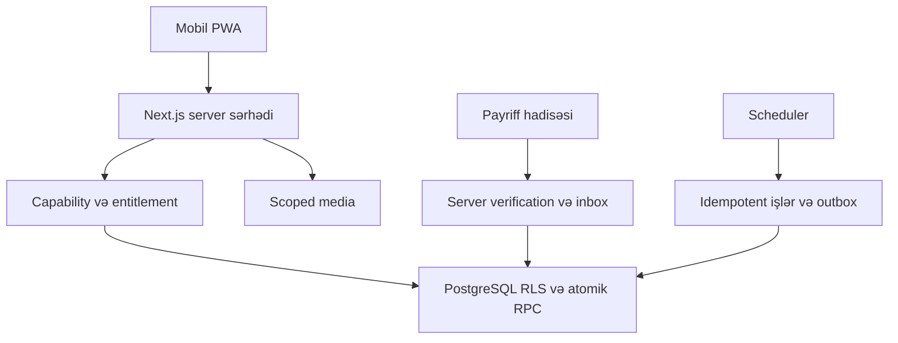

# Texniki arxitektura

## Qərar

Bir Git repository-də **modul monolit**: Next.js App Router + TypeScript strict, Supabase PostgreSQL/Auth/Storage. Tailwind/shadcn/Lucide, React Hook Form/Zod, next-intl. Production hosting Vercel Pro. Microservice, Redis, Kubernetes, native app və əlavə ORM ilkin tələb deyil.

DB schema və migrations Supabase SQL ilə; user əməliyyatları user-scoped client və yoxlanmış SQL RPC-dən keçir. Generated types CI-da uyğunlaşdırılır. Tranzaksiya tələb edən biznes əməliyyatları SQL RPC-də atomikdir. SECURITY DEFINER minimal, sabit search_path və explicit capability yoxlamalıdır.

Fiziki grant/RPC sərhədi üçün [ACCESS-BOUNDARY](ACCESS-BOUNDARY.md) normativdir: app_private base tables + yalnız api allowlist RPC; authenticated və anon üçün base-table grant yoxdur. Həssas sütunlar tək RLS ilə gizlədilmir.

| Modul | Sahib olduğu məntiq |
|---|---|
| identity/access | Auth, profil, tenant, ev təyinatı, capability |
| properties | Ev, ayar, hazırlıq, public draft |
| reservations | Hold, occupancy, tarix/ev dəyişmə, giriş/çıxış |
| finance | Rent ledger, depozit, realtor, expense |
| operations | Kontakt, task, cleaning, notifications |
| inventory | Otaq/əşya, snapshot, day/event/submission |
| publishing | Public DTO, dil/guide, QR, scoped link |
| billing | Eve order, Payriff, entitlement, reconciliation |
| operator | Support, audit, failed billing |

## Planlaşdırılan qovluqlar

app/(auth), app/(panel), app/p, app/g, app/s, app/api/v1; src/modules/{module}; src/components/ui; src/design; src/lib/supabase; supabase/migrations; supabase/tests; tests/unit; tests/integration; tests/e2e; docs.

Bunlar M1-də yaradılacaq, hazır tətbiq qovluğu sayılmır.

Tenant client-dən qəbul edilmir, səlahiyyətli evdən tapılır. User read/write RLS-dən keçir. Billing/scheduler secret client yalnız serverdə və ayrıca payload yoxlaması ilədir. Public endpoint private table select-i açmır.

## Asinxron işlər

Supabase Cron + SQL/outbox ilkin seçim: hold expiry, day creation, recurring reminders, payment reconcile, notification retry. Job schedule/timezone, idempotency, lock, timeout, retry/backoff və failed status saxlayır. External HTTP qısa batch Edge Function ilə; M1-də provider imkanları yoxlanılır.

Job correctness-in yeganə qatı deyil: expired hold booking tranzaksiyasında bağlanır. Bildiriş çatmaması rezervasiyanı geri qaytarmır; outbox commitlə birlikdə yazılır.

## Cache / offline

Private response və RSC data tenant/capability sərhədi olmadan shared cache-də deyil. Token səhifələri no-store/no-referrer. Service worker statik qabıq və zərərsiz asset-lər üçündür; private data offline persistence yoxdur. Logout client state-ni təmizləyir. Public məzmun published version üzrə cache; availability no-store.

Realtime ilkin tələb deyil: mutation invalidation + focus refresh. Optimistic versioning mütləqdir. TanStack Query yalnız client cache ehtiyacı sübut olunarsa əlavə edilir.

## Performans

Açıq interval üzrə calendar query, pagination, property/date index-ləri, N+1 olmadan query. Cover ölçüsü sabit, image compression/srcset, video lazy. Bundle və DB EXPLAIN M7-də ölçülür. Provider/media vaxtı adi server query metrikasından ayrıdır.

## Mühitlər

Local/staging/production ayrı Supabase/Payriff credential-ları. Preview production DB-yə yazmır. Secret yalnız server env store; .env.example placeholder. M1-də dəstəklənən stable framework/Node LTS/package manager versiyası sabitlənir, lockfile commit edilir. Migration rollback/forward-fix planı olmadan production schema dəyişmir.

Supabase üçün `NEXT_PUBLIC_SUPABASE_URL` və `NEXT_PUBLIC_SUPABASE_PUBLISHABLE_KEY` public client config-dir; publishable key RLS-i əvəz etmir. `SUPABASE_SECRET_KEY` yalnız server mühitində saxlanır və yalnız ayrıca səlahiyyət yoxlaması olan server əməliyyatında istifadə oluna bilər. Server-only accessor Next.js `server-only` sərhədi ilə işarələnir. Local build bu dəyərlər olmadan işləyə bilər; Supabase client konfiqurasiyası istənən anda çatışmayan və ya etibarsız dəyər aydın xəta verməlidir. Real key yalnız `.env.local` və ya mühit secret store-a daxil edilir; `.env.example` boş placeholder saxlayır.
