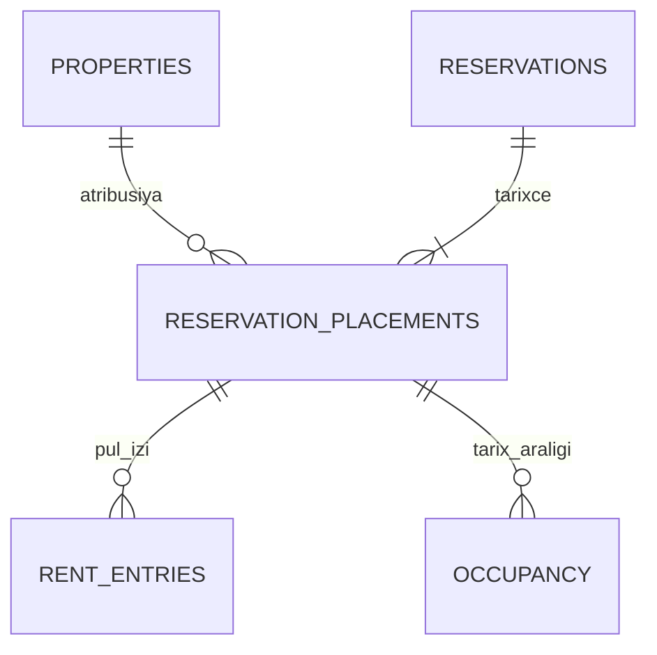

# Məlumat modeli — icra üçün tam müqavilə

**Versiya:** 2.0.0 · **Dil:** Azərbaycan dili · **Status:** sxem spesifikasiyası, tətbiq edilmiş migration deyil.

Maşınla oxunan əsas müqavilə: **[data-dictionary.json](data-dictionary.json)**. Orada 52 cədvəlin hər sütunu üçün PostgreSQL tipi, null qaydası, default, məqsəd və validasiya; PK, UNIQUE, kompozit FK, indeks, CHECK/trigger, RLS və saxlanma sinfi açıq verilib. Sütun əlavə etmək və ya enum dəyişmək JSON müqaviləsi, API və testləri eyni PR-də yeniləməyi tələb edir.

## 1. Ümumi qərarlar

| Mövzu | Məcburi qayda |
|---|---|
| Identifikator | UUID; DB default `gen_random_uuid()`; public slug ayrıca təsadüfi dəyərdir |
| Zaman | `timestamptz` UTC saxlanır; calendar günü və billing anchor `Asia/Baku` ilə hesablanır |
| Pul | `bigint`, AZN qəpik, `0..9007199254740991`; actual pul hadisəsində məbləğ >0 |
| Say | Ədəd/sərf üçün `numeric(12,3)`; mənfi say yoxdur, vahid ayrıca göstərilir |
| Versiya | Mutable qeyddə integer `version>=1`; server hər uğurlu dəyişiklikdə artırır |
| Default | JSON-da `null` default = SQL DEFAULT yoxdur; nullable ayrıca göstərilir, bu iki anlayış qarışmır |
| Enum | `enums` reyestri versiyalıdır; DB enum və ya CHECK ilə eyni literal-lar qorunur |
| JSON | `objects` bölməsinin tip/limit qaydalarından kənar arbitrary payload/HTML qəbul edilmir |
| Silinmə | Domain FK-larda `ON DELETE RESTRICT`; archive və hüquqi purge ayrı prosesdir |
| Secret | Raw token, password, kart PAN/CVV Eve cədvəllərində yoxdur |

`auth.users` xarici, Supabase tərəfindən idarə olunan cədvəldir. Eve yalnız UUID ilə bağlanır; email kimliyi oradan doğrulanır. `profiles` ayrıca qlobal owner/manager rolunu saxlamır.

## 2. Sxemin xəritəsi

| Qrup | Cədvəllər | Məqsəd |
|---|---|---|
| Kimlik və icazə | profiles, owner_accounts, property_memberships, manager_invites, invite_properties | Bir hesab, ayrı sahib tenant-ları və ev üzrə manager təyinatı |
| Əmlak və xidmət əlaqəsi | properties, contacts, contact_properties | Əsas məlumat, hazırlıq, usta/realtor/təmizlikçi əlaqəsi |
| Rezervasiya | reservations, reservation_placements, reservation_attribution_transfers, manual_blocks, occupancy | Cari rezervasiya, tarixçə və vahid overlap müdafiəsi |
| Kirayə uçotu | rent_entries, realtor_accounts, realtor_settlements | Qonaq pulu, depozit və realtor hesabı |
| Xərc | expenses, expense_allocations, expense_payments, recurring_expenses | Təklif/təsdiq, evlərə paylama və faktiki ödəniş |
| İşlər | tasks | Qəbul, nəticə, təsdiq və hazırlıq bağlantısı |
| Daimi inventar | rooms, inventory_items | Əşyalar və sərf ehtiyatı |
| Təhvil yoxlaması | inspection_days, inspection_events, inspection_snapshots, inspection_snapshot_rooms, inspection_snapshot_items, inspection_submissions, inspection_room_answers, inspection_answers | Gün/hadisə/tərəf üzrə dəyişməz nüsxə və ayrı cavab |
| Məzmun və media | guides, guide_versions, public_pages, access_links, media_assets, media_bindings | Public, safety və guest-private sərhədi |
| SaaS | trial_claims, subscriptions, billing_orders, billing_order_lines, subscription_periods, payment_events | Eve xidmət haqqı və entitlement |
| İnfrastruktur | idempotency_keys, outbox, audit_events, support_requests, notification_preferences, push_subscriptions | Etibarlı icra, bildiriş və dəstək |
| Toplu əməliyyat | import_jobs, import_rows, export_jobs | Preview/hash/confirmation və scope ilə import/export |

## 3. Tenant və capability sərhədi

`owner_accounts.owner_user_id` unikal sahib hesabıdır. Əmlakda bir `owner_account_id` var; manager bunu dəyişə bilməz. Bir manager eyni vaxtda müxtəlif sahiblərin evlərinə təyin oluna bilər.

Property child cədvəllər `(property_id, owner_account_id)` kompozit FK-sı ilə qorunur. Eyni sahibə aid olmaq eyni evə aid olmaq demək deyil: rezervasiya/task/əşya bağlantılarında property tuple da yoxlanır. Request-dən gələn owner ID authoritative deyil; server icazəli əmlakdan çıxarır.

**RLS yalnız sətrə giriş verir, sütun gizlətmir.** Gündəlik manager üçün xərclər, private kontakt qeydləri, tenant mənfəəti və tarixi başqa-ev qeydləri birbaşa `SELECT *` ilə açılmır. Client role-a base-table grant verilmir. Normativ qərar [ACCESS-BOUNDARY](ACCESS-BOUNDARY.md)-dədir: app_private base schema + api allowlist RPC, NOBYPASSRLS/table-owner olmayan executor, sabit search_path və cari actor/property capability yoxlaması.

| Oxucu | Görə bildiyi data |
|---|---|
| Sahib | Öz tenant-ının bütün evləri və domain məlumatı |
| Daily manager | Cari həvalə edilmiş evin rezervasiya qiyməti/qonaq pulu, iş və inventar; öz xərc təklifi |
| Full manager | Həvalə edilmiş evlər üçün maliyyə; başqa allocation-ları olan xərc başlığının tam cəmi ayrıca gizlədilir |
| İşçi keçidi | Yalnız hədəf tapşırıq/yoxlama forması və ona bağlı media |
| Public | Yalnız published safe DTO; base-table grant yoxdur |
| Operator | Redacted support/billing metadata; səbəbli ayrıca səlahiyyət |

Üzvlük hər request-də cari DB vəziyyətindən yoxlanır. Köhnə JWT və açıq tab ləğv edilmiş membership-i bərpa etmir.

## 4. Rezervasiya və overlap

Gecələmə intervalı `[check_in,check_out)`-dır; `check_out>check_in`. Checkout sərhədi həmin gecə tutulması deyil. `occupancy` booking/hold və manual bloku bir cədvəldə saxlayır; ayrı cədvəllər üzrə toqquşmadan yan keçmək mümkün deyil.

Məcburi DB məhdudiyyəti: `EXCLUDE USING gist (property_id WITH =, date_range WITH &&) WHERE (active)`. `btree_gist` extension miqrasiyada açılır. `now()` partial predicate-ə yazılmır.

Hər create/update/move tranzaksiyası:

1. Təsirlənən evlərin row lock-larını UUID sırası ilə alır.
2. Cari capability, entitlement və expected_version yoxlayır.
3. Vaxtı bitmiş hold-ları və onların occupancy-sini bağlayır.
4. Date range və tarif/quote-u serverdə hesablayır.
5. Reservation/placement/occupancy-ni atomik yeniləyir.
6. Task düzəlişi, audit və outbox niyyətini həmin commit-ə bağlayır.

Cron gecikməsi availability düzgünlüyünü pozmur. Cancel/no-show aktiv intervalı azad edir. Erkən faktiki çıxış özbaşına plan tarixini açmır; ayrıca “Qalan günləri aç” qərarı version və qiymət ilə təsdiqlənir.

## 5. Ev dəyişməsində maliyyə tarixçəsi

Mutable `reservations.property_id`-ə köhnə receipt FK-sını bağlayıb sonra onu dəyişmək FK bütövlüyünü və maliyyə tarixçəsini poza bilər. Buna görə **reservation_placements** istifadə edilir.

Hər rezervasiyanın cari `current_placement_id`-si var. Placement property/owner aidiyyətini saxlayır. `rent_entries`, tarixi task və yoxlama hadisələri aid olduqları placement-a FK ilə bağlanır. Bu FK-lar ev dəyişməsində yenidən yazılmır.

### İcazəli move tranzaksiyası

1. Mənbə və hədəf ev **eyni sahibə** aid olmalıdır. İlkin versiyada cross-owner move bütün hallarda rədd edilir.
2. Actor hər iki evdə `reservation.write` hüququna malik olmalıdır; mənbə və hədəf entitlement aktiv olmalıdır.
3. Hər iki ev lock edilir və hədəfin uyğun tarixləri yoxlanır.
4. Əvvəlki placement yalnız `effective_to` sahəsində bir dəfə bağlanır. Qalan sütunlar dəyişmir.
5. Yeni placement və qeyri-pul `reservation_attribution_transfers` qeydi yaradılır; net kirayə/depozit vəziyyəti snapshot kimi yazılır.
6. Reservation current pointer/property yenilənir, köhnə active occupancy bağlanır, hədəfdə yeni occupancy yaranır.
7. Əvvəlki tamamlanmamış gələcək cleaning task ləğv edilir və hədəfdə lazımi iş yaradılır; tamamlanmış task və yoxlama silinmir.
8. Köhnə placement-in guest-private keçidləri və private media girişi həmin tranzaksiyada ləğv edilir; yeni ev üçün keçid yalnız hədəf icazəsi ilə ayrıca yaradılır.
9. Audit/outbox eyni tranzaksiyada yazılır; yarımçıq transfer commit edilmir.

### Hesabat və görünüş

- **Qonağın borcu** rezervasiyanın bütün placements üzrə rent receipt/refund cəmindən hesablanır. Buna yalnız cari rezervasiyanı oxuma hüququ olan şəxs baxır.
- **Əmlakın faktiki pul axını** receipt baş verən tarixi əmlakda qalır.
- **Rezervasiya gəliri** cari aidiyyətə bağlanır; qeyri-pul transfer income attribution-u izah edir, yeni customer receipt yaratmır.
- **Yalnız mənbə evə çıxışı qalan manager** hədəf evin adını/ünvanını, cari qonaq məlumatını və cari rezervasiya ekranını görə bilmir. İcazəsi varsa yalnız öz evinin minimal tarixi cash/attribution projection-unu görür.
- Placement-dən cari reservation-a join edərək guest/target məlumatını gizli açmaq qadağandır.

Bu ayrılıq UI-da üç əlavə menyu yaratmır; istifadəçi “Evi dəyiş” əməliyyatını edir, tarixçə arxa planda qorunur.

## 6. Pulun bütövlüyü

SaaS və kirayə cədvəlləri ayrıdır. Eve kirayə pulunu qəbul etmir; `rent_entries` sahibin uçotudur.

`rent_entries.kind`: rent_receipt, rent_refund, deposit_receipt, deposit_return, deposit_to_rent, deposit_to_damage, reversal. API qısa seçim göstərirsə ledger mapping-i API müqaviləsində açıq olmalıdır. Mənfi məbləğ yox, explicit növ və original entry bağlantısı var.

Refund/depozit çıxışı mənbə entry-yə bağlanır, həmin reservation-a aid olması və qalan net limit row lock altında yoxlanır. Deposit gəlir deyil. `deposit_to_rent` və `deposit_to_damage` sahib/full səlahiyyəti və əsaslandırma tələb edir. Reversal yalnız sahib/full maliyyə səlahiyyəti ilə yeni hadisədir; əvvəlki qeyd silinmir. Pul, realtor settlement və xərc ödənişi üçün `operation_key` maliyyə retention müddətində unikal saxlanır; qısaömürlü idempotency cache-in təmizlənməsi köhnə sorğunu ikinci pula çevirmir.

Komissiya razılaşması `realtor_accounts`-da reservation+owner səviyyəsində qalır; settlement isə baş verdiyi dəyişməz placement-a bağlanır. Evi dəyişmək köhnə komissiya köçürmələrini yenidən yazmır.

Realtor komissiyasında faiz integer basis point-dur: 1000 = 10%. Faiz bazası rent razılaşmasıdır, depozit deyil. Half-up yuvarlaqlaşdırma serverdə bir dəfə edilir. Realtor-to-owner settlement customer rent receipt-i deyil; eyni pul iki dəfə gəlir yaratmır.

Xərc başlığının allocation cəmi commit vaxtında `total_minor`-ə bərabər olmalıdır. Expense və refund/payment mənbə sətri lock edilir. Paralel ödənişlər qalıqdan artıq məbləğ yaza bilməz. Partial payment derived status ilə uyğunlaşdırılır; proposed expense təsdiqli gəlir/xərc hesabatına daxil deyil.

## 7. Gündəlik yoxlama və immutable snapshot

**Gün konteksi ≠ məcburi tapşırıq.** `inspection_days` yalnız ev/Bakı günü üzrə unikaldır. Həmin gün bir neçə check-in/out varsa `inspection_events` ayrıca yaranır. Cavab açarı `event + side + revision`-dur; təkcə property/date deyil.

Snapshot ilk yoxlama başlandıqda bir dəfə yaranır. Otaq və əşyalar normalizə snapshot cədvəllərinə kopyalanır, source inventory ID yalnız tarixçəni izah edir. Daimi inventar sonradan dəyişsə yoxlama siyahısı dəyişmir.

Hər tərəfin bir açıq draft-ı ola bilər; verən/alan ayrı qeyddir. Otaq cavabı `ok/problems/unable`; item condition `ok/missing/damaged/unable`. Missing üçün actual_quantity, unable otaq üçün səbəb tələb olunur. Heç nə əvvəlcədən təsdiqlənmir.

Finalize tranzaksiyası snapshot otaqlarının hamısına cavab olduğunu və problemli otaqda uyğun item cavabı mövcudluğunu yoxlayır. Completed submission və bağlı cavabların update/delete-i trigger ilə bloklanır. Düzəliş yeni revision və previous_submission_id yaradır; əvvəlki cavab qalır.

Adını yazan şəxs claimed identity-dir. `actor_user_id` yalnız doğrulanmış sessiyadan gəlir. Yoxlama avtomatik inventar silinməsi, depozit tutulması və ev bloklanması yaratmır.

## 8. Token və media referensləri

Polymorphic `resource_type + resource_id` sətirinə güvənilmir. `access_links`-də task_id, inspection_event_id və reservation_id/placement_id typed FK-ları var. CHECK hər kind üçün yalnız doğru target kombinasiyasına icazə verir; inspection tərəfi boş ola bilməz. Unspecified tərəf seçiləndə server tərəf-scoped link/draft yaradır.

Raw token deyil, SHA-256 hash saxlanılır. Scope həmin kind-in allowlist-indən gəlir. Link GET-i vəziyyət dəyişmir; explicit POST idempotentdir. Expiry/revoke hər media sorğusunda da yoxlanır.

`media_bindings` real task/expense/inspection-answer/guide-version/inventory FK-sına və ya ev qalereyasına bağlanır. Dəqiq bir target var. Storage path-in özündən səlahiyyət çıxarılmır. Expense qəbzi yalnız onun allocation-ına aid evə bağlana bilər. Altı classification üçün D33-dəki ayrı bucket-lər və `media_assets` CHECK-i tətbiq olunur. Bucket-lərin hamısı Storage səviyyəsində private-dir; public yayımlama safe server projection-u, scoped private oxuma hər sorğuda yoxlanan proxy ilə aparılır.

Guide classification: general_public, safety_public, guest_private. Dərc edilmiş versiya dəyişməzdir, redaktə yeni draft version yaradır. Sabit QR slug nüsxənin pointer-idir. Abunə expiry-si əvvəl yayımlanmış safety mətn/şəkli silmir; qapı kodu və Wi-Fi şifrəsi public safety blokuna daxil deyil.

## 9. Billing idempotentliyi və sınaq

`trial_claims.owner_account_id` unikaldır; ilk ev create və trial claim bir tranzaksiyadır. Parallel tab, archive və delete yeni trial vermir. Yeni email ilə abuse-un tam qarşısı alındığı iddia edilmir.

Order və order line-lar bir owner-a aiddir. Server kataloqu monthly=999, yearly=9999 qəpikdir. `payment_events` provider+event_key unikaldır, lakin əsas ikinci sədd `subscription_periods.order_line_id UNIQUE`-dur: fərqli event key ilə eyni payment yenə bir dəfə tətbiq edilir.

Order verification/application eyni order/property lock ardıcıllığı ilə işləyir. Provider server doğrulaması olmadan browser return paid vəziyyəti yarada bilməz. Məbləğ, valyuta, merchant və order uyğunluğu məcburidir.

Calendar anchor ayrıca saxlanır: 31 yanvar → fevralın son günü → 31 mart qaydası üçün son clamp edilmiş gün yeni anchor sayılmır. Bir illik/aylıq müddət satın alındıqda cari ödənmiş/sınaq bitməsindən sonrakı period yaradılır. `starts_at < ends_at`; eyni evin paid period-ları overlap etmir. UI state projection-u ilə append-only dövr tarixçəsi qarışmır.

## 10. Saxlanma və hüquqi silinmə

Dictionary retention class-ları operational, financial, billing, audit, media, ephemeral, credential kimi ayırır. **Hüquqi saxlama ili uydurulmur.** EXT07 təsdiqi tələb olunan müddətlər production gate-də ayrıca bağlanır.

Archive entitlement-i dondurmur və FK məlumatını silmir. Hüquqi silinmə ayrı service prosedurudur: identity doğrulama, scoped link revoke, qanuni saxlanmalı qeydin minimallaşdırılması, private media purge və backup expiry siyasəti. Safety QR üçün “abunə bitməsi” ilə “hesabın hüquqi silinməsi/xidmətin bağlanması” eyni deyil.

Outbox payload/audit generic resource metadata-sı authorization mənbəyi deyil. İşləyən worker resursu yenidən typed domain FK/capability ilə oxuyur. Event-lərdə raw token saxlanmır; göndəriş üçün lazım olan yeni bearer link işin icrası zamanı serverdə yenidən yaradılır və expired/revoked niyyət göndərilmir.

## 11. İcra və qəbul

Dictionary-də CHECK ifadəsi ilə təsvir edilmiş cross-row qayda migration-da SQL CHECK ola bilmirsə deferred constraint trigger/locked RPC ilə eyni named invariant kimi icra edilir. Tək application precheck kifayət deyil. JSON field validasiyası həm server schema, həm DB minimal CHECK-ləri ilə qorunur.

M1 migration paketi dictionary-nin bütün PK/FK/unique/check/index-lərini qarşılamalı, generated types API ilə uyğunlaşdırılmalıdır. AT04–06, AT07–14, AT17–28, AT32–35 mənfi/race sınaqları məcburidir. Bu sənəddəki FK və trigger qaydaları hələ real DB-də icra edilməyib; onların işləməsi yalnız migration test sübutu ilə təsdiqlənəcək.
